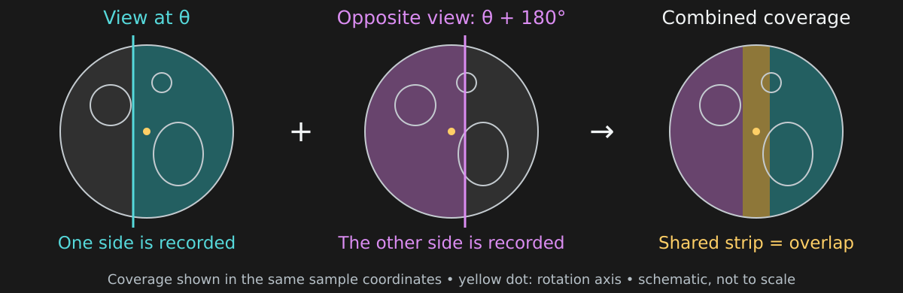

Find the centre and overlap in a 360-degree scan
================================================

``find_center_360``

Estimate overlap between opposing parts of a 360-degree sinogram, then infer the rotation centre. This supports offset-axis scans with a field of view wider than the detector.

Usage and parameters
--------------------

Choose ind for the detector row and inspect the returned centre, overlap and overlap side. Pass overlap and side to sino_360_to_180 when converting the data. Match the scan angular sampling to the opposing-view assumption; motion between halves can spoil the match. See :cite:`vo2021data`.

Offset scans and the overlap
----------------------------

   Offset-scan coverage, reused from the HTTomo workshop. The two views are
   shown in the same sample coordinates; yellow marks the rotation axis.

When a sample is wider than the detector, move the rotation axis towards a
detector edge and acquire a full turn. Views separated by 180 degrees then
cover complementary sample regions. The shared strip determines their overlap.
A centred 360-degree scan supplies redundant views and does not by itself
extend the field of view.

From centre finding to stitching
--------------------------------

Use this method to estimate the centre, overlap width and overlap side, then
pass the overlap and side to :func:`~httomolibgpu.misc.morph.sino_360_to_180`.
The :doc:`360-to-180 stitching guide <../geometry/sino_360_to_180>` includes a
captioned animation showing how the opposing views are flipped and combined.

Papers and further reading
--------------------------

* `Data processing methods and data acquisition for samples larger than the field of view in parallel-beam tomography <https://doi.org/10.1364/OE.418448>`_.

Validation examples and images
------------------------------

See :doc:`the saved validation notebook <../../../validation/rotation/center_360>`.
Three full-turn scans with the original integer centre, integer overlap and side checks, plus stitched-sinogram plots.

.. note:: In the current wrapper, the first return value is the input detector
   width (the value called ``cor`` in the historical tests), not an independent
   estimate of the rotation axis in raw detector coordinates. The overlap and
   side are the estimated quantities used for 360-to-180 conversion. The
   validation notebook preserves and explains this return-value convention.

API reference
-------------

:func:`httomolibgpu.recon.rotation.find_center_360` — signature, input/output types and full parameter details.
