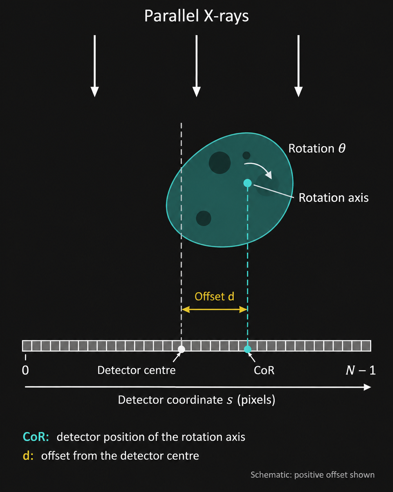

.. _cor_finder_module:

Centre of Rotation
******************

Methods from :mod:`httomolibgpu.recon.rotation` module are used for automatic determination of the centre of rotation (COR). The centre of rotation (COR) is a critical parameter in tomographic reconstruction. An incorrect COR introduces characteristic reconstruction artefacts, including blurring, double edges, and duplicated structures. See more about CoR `here <https://diamondlightsource.github.io/httomo/howto/httomo_features/centering.html>`_

   Workshop schematic: the centre of rotation is the detector coordinate of
   the rotation axis. Its displacement from the detector centre is an offset,
   not the position of the sample's centre of mass.

For an animated Fourier-consistency search, see
:doc:`Vo centre finding <cor_finder/find_center_vo>`. For the geometry of a
full-turn offset scan and its overlap, see
:doc:`360-degree centre finding <cor_finder/find_center_360>` and the
:doc:`360-to-180 conversion animation <geometry/sino_360_to_180>`.

.. toctree::
   :maxdepth: 2

   cor_finder/find_center_metric_recon

.. toctree::
   :maxdepth: 1

   cor_finder/find_center_vo
   cor_finder/find_center_360
   cor_finder/find_center_pc
