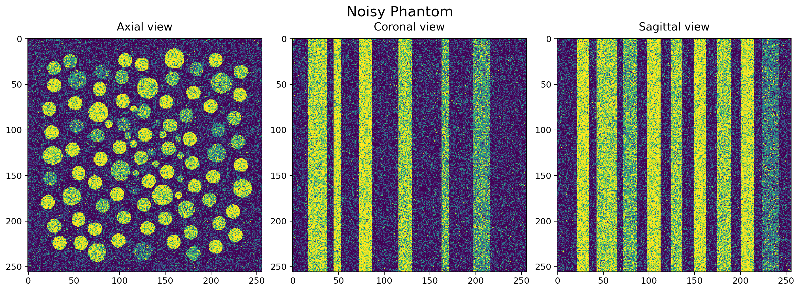
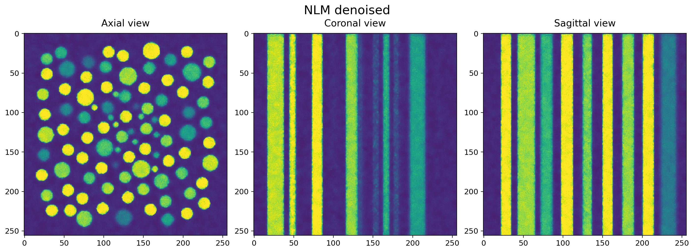

.. _method_non_local_means:

Non-local means denoising
^^^^^^^^^^^^^^^^^^^^^^^^

**Description**

Non-local means (NLM) denoising reduces noise by averaging pixels or voxels
with similar surrounding patches. Instead of smoothing all nearby pixels
equally, it gives more weight to those whose local structure resembles the
patch being filtered. This helps preserve edges and repeated features in
images and volumes.

The following figures show axial, coronal and sagittal views of a phantom
before and after NLM denoising.

   The noisy phantom.

   Recovery using NLM denoising.

Mathematically, the denoised value at position :math:`p` is a weighted
average of candidate values within a search window:

.. math::

   \hat{u}(p) = \frac{\sum_{q \in S(p)} w(p,q) u(q)}
                        {\sum_{q \in S(p)} w(p,q)}, \qquad
   w(p,q) = \exp\left(-\frac{d(p,q)}{h^2}\right),

where :math:`S(p)` contains the selected neighbours and the centre pixel.
The patch distance :math:`d(p,q)` is the sum of Gaussian-weighted squared
intensity differences between the two patches. Similar patches receive
larger weights; the centre pixel has weight one. At image boundaries,
only valid patch elements are compared, without renormalising the Gaussian
weights.

**Where and how to use it:**

Use :func:`httomolibgpu.misc.denoise.non_local_means` to reduce noise in
reconstructed images or volumes, particularly when preserving repeated
structures and fine features is important. The method accepts a float32
CuPy image or volume and returns a new denoised array on the GPU, leaving
the input unchanged. Input values must be finite.

By default, volumes are processed in 3D, using neighbouring slices to
compare patches. Set :code:`full_3d=False` to denoise each axial slice
independently. A 2D input always uses 2D processing.

.. code-block:: python

   import cupy as cp
   from httomolibgpu import non_local_means

   # A starting point for image intensities approximately in [0, 1].
   images = cp.asarray(reconstructed_volume, dtype=cp.float32)
   denoised = non_local_means(
       images,
       h=0.2,
       search_radius=2,
       patch_radius=1,
       num_neighbours=0,
       full_3d=True,
   )

**What are the adjustable parameters:**

* :code:`h` Controls the level of smoothing. Larger values allow less-similar
  patches to contribute and can lead to oversmoothing. The value must be
  positive and is expressed in input intensity units; the method does not
  normalise the data. Patch distances are summed rather than averaged, so
  retune this parameter when changing the intensity scale, patch radius or
  processing dimension. Defaults to 0.1.

* :code:`search_radius` Sets the half-width of the search window. The default
  value of 2 gives a 5 by 5 window in 2D or a 5 by 5 by 5 window in 3D. Larger
  windows allow more distant matches but increase computation time. Zero
  returns a copy of the input.

* :code:`patch_radius` Sets the half-width of each comparison patch and the
  standard deviation of its Gaussian weighting. The default value of 1 gives
  a 3 by 3 patch in 2D or a 3 by 3 by 3 patch in 3D. Larger patches increase
  computation time and may require a larger :code:`h`. Zero compares
  individual pixels.

* :code:`num_neighbours` Limits averaging to the strongest non-self matches,
  together with the centre pixel. The default of zero uses all candidates.
  A positive value cannot exceed the number of non-centre positions in the
  search window; fewer matches may be available at image boundaries.

* :code:`full_3d` Enables volumetric search windows and patches for a 3D
  input. Defaults to True. Set it to False to process each
  :code:`data[z, :, :]` slice independently, reducing computation time
  while excluding information from neighbouring slices.

.. note:: Denoising after reconstruction cannot generally recover information
   lost through undersampling or remove strong reconstruction artefacts.
   For poor-quality projection data, consider regularisation within an
   iterative reconstruction method such as :ref:`method_FISTA3d_tomobar`.

.. note:: When processing a volume in chunks with :code:`full_3d=True`,
   include an overlap of :code:`search_radius + patch_radius` voxels on
   each side of every chunked axis, then retain only the chunk interior.
   Without overlap, chunk boundaries can introduce differences from
   filtering the whole volume. Independent slice processing needs no
   overlap along the slice axis.
