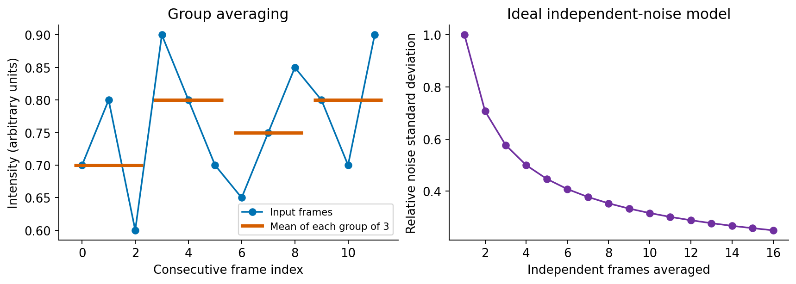

Average consecutive projection frames
=====================================

``average_projection_frames``

Reduce the angular dimension by averaging consecutive groups of projection frames. This can reduce independent noise and data size, but averaging different angles also blurs angular detail.

Principle
---------

.. math::

   \overline{P}_j=\frac{1}{|G_j|}\sum_{i\in G_j}P_i

Usage and parameters
--------------------

G_j contains up to projection_averaging_factor consecutive frames; a final incomplete group is averaged over its actual size. Update the angle vector to describe the averaged groups. Integer input retains its dtype and therefore cannot retain fractional averages.

Illustration
------------

   Synthetic grouping example and the ideal independent-noise model. Real projection averaging also changes angular sampling and can blur moving features.

Implementation reference
------------------------

See the `library implementation <https://github.com/DiamondLightSource/httomolibgpu/blob/main/httomolibgpu/misc/morph.py>`_
for the precise numerical conventions used by this utility.

Background reading
------------------

For the transmission model, sampling and reconstruction context, see
Kak and Slaney, `Principles of Computerized Tomographic Imaging
<https://www.slaney.org/pct/>`_ (author-hosted text). The numerical
controls specific to this function are defined in the API above.

API reference
-------------

:func:`httomolibgpu.misc.morph.average_projection_frames` — signature, input/output types and full parameter details.
