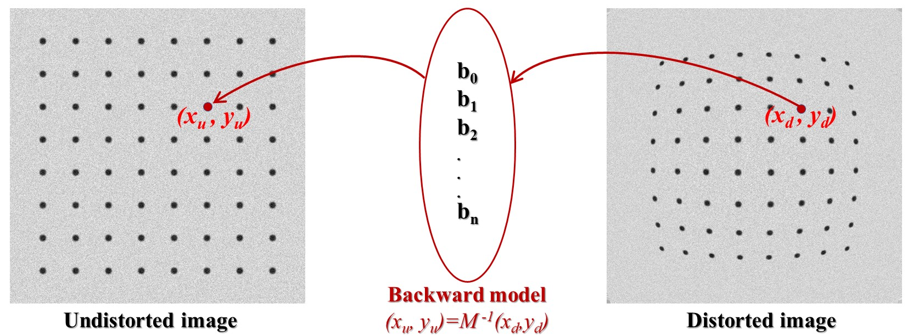
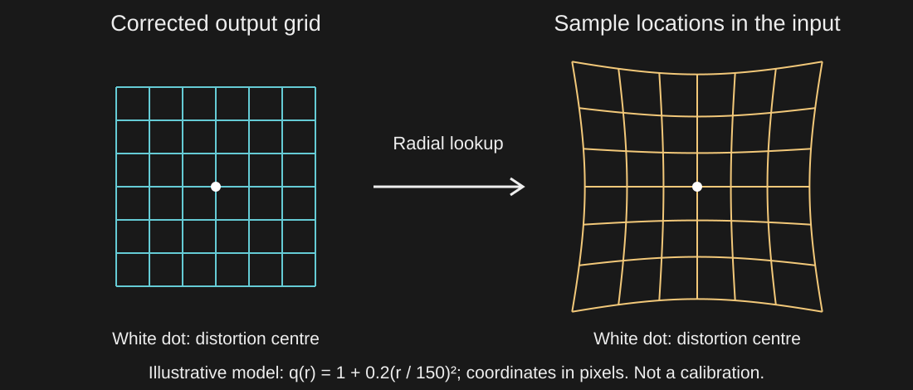
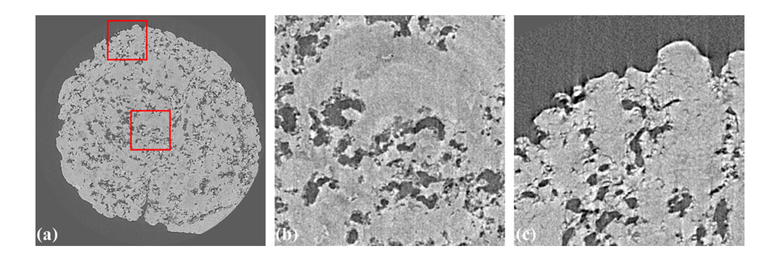
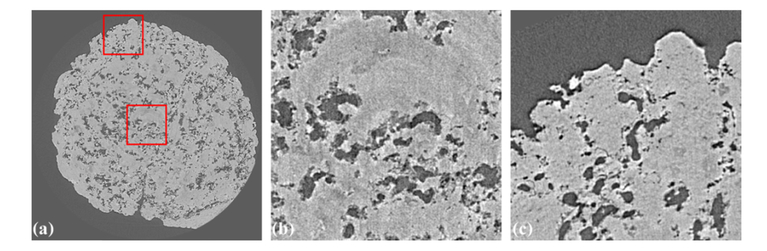

Correct detector distortion
===========================

``distortion_correction_proj_discorpy``

Unwarp each projection using a calibrated backward radial distortion model and interpolation. Use a calibration acquired for the same detector and optics.

Principle
---------

.. math::

   r_{\mathrm{source}}=r_{\mathrm{output}}\sum_k a_k r_{\mathrm{output}}^k

Usage and parameters
--------------------

Radii are measured from the distortion centre. Supply coefficients and centre coordinates, or a calibration metadata_path. A backward model maps output coordinates to source coordinates. Incorrect coefficients or cropping offsets can introduce geometric errors.

Calibration and backward mapping
--------------------------------

   Distorted grid (right) and undistorted grid (left). Reused from the HTTomo
   workshop; original image: `Discorpy methods documentation, Fig. 2.2.1.2
   <https://discorpy.readthedocs.io/en/latest/tutorials/methods.html>`_.

First calibrate the optics using a known dot or line pattern. Then use the
estimated centre and backward polynomial coefficients to sample each measured
projection onto a regular corrected grid. This function applies calibration;
it does not estimate the coefficients from the tomography projections.

   Illustrative coefficient-to-coordinate mapping from the workshop. It is a
   schematic, not the calibration of the acquisition being processed.

Reconstruction before and after correction
------------------------------------------

   Before correcting projection distortion: full reconstruction (a), central
   detail (b) and edge detail (c). Streaking is especially visible near the edge.

   After correction: corresponding views show reduced streaking and clearer
   boundaries. These are reconstructed slices, not raw detector images.

Both reconstruction figures are reused from the workshop, which credits
Vo, Atwood and Drakopoulos (2019), `Preprocessing techniques for removing
artifacts in synchrotron-based tomographic images
<https://doi.org/10.1117/12.2530324>`_, Figs. 4 and 8. They illustrate the
benefit of calibrated geometry correction, rather than a validation run of
this exact HTTomolibGPU wrapper.

Papers and further reading
--------------------------

* `Radial lens distortion correction with sub-pixel accuracy for X-ray micro-tomography <https://doi.org/10.1364/OE.23.032859>`_.

API reference
-------------

:func:`httomolibgpu.prep.alignment.distortion_correction_proj_discorpy` — signature, input/output types and full parameter details.
