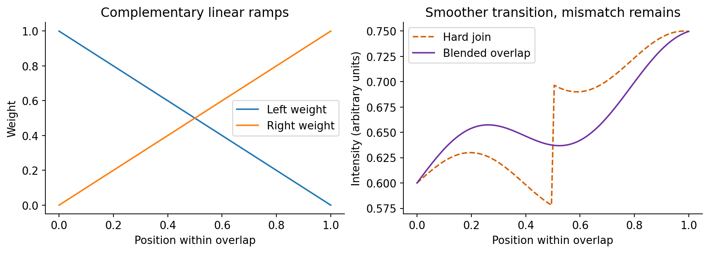

Blend stitched projection seams
===============================

``seam_blend_stitched_data``

Blend overlapping left and right detector images using complementary linear ramps. This reduces a visible seam in already stitched projection stacks.

Principle
---------

.. math::

   I_{\mathrm{blend}}(j)=(1-w_j)L(j)+w_jR(j),\quad w_j=j/(n-1)

Usage and parameters
--------------------

Here n is the overlap width and j runs across the overlap (n > 1). Set overlap from the acquisition and seam_index at the join. The output detector width shrinks by overlap pixels. Blending does not estimate registration or correct an intensity mismatch.

Illustration
------------

   Synthetic overlap illustration. Blending softens a join but does not remove an intensity mismatch between the two images.

Papers and further reading
--------------------------

The paper below provides acquisition and overlap-stitching context; the
linear blending ramp above describes this library implementation.

* `Data processing methods and data acquisition for samples larger than the field of view in parallel-beam tomography <https://doi.org/10.1364/OE.418448>`_.

API reference
-------------

:func:`httomolibgpu.misc.blend.seam_blend_stitched_data` — signature, input/output types and full parameter details.
