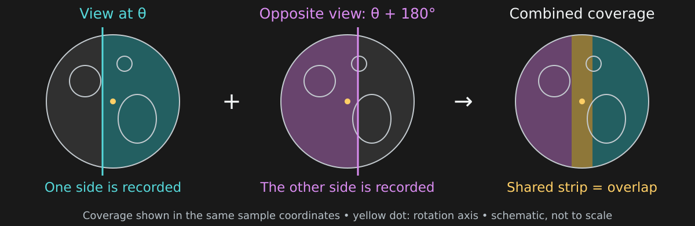

Convert 360-degree sinograms to 180 degrees
===========================================

``sino_360_to_180``

Combine redundant opposing views from an offset-axis 360-degree acquisition into wider 180-degree sinograms. The overlap and its side specify how the opposing detector views meet.

Principle
---------

.. math::

   p(\theta,s)=p(\theta+\pi,-s)

Usage and parameters
--------------------

The identity describes ideal parallel-beam redundancy about the rotation axis. Obtain overlap and side from find_center_360. An odd input projection count drops the last projection. Keep the associated angles consistent with the reduced projection count.

Offset scans and the overlap
----------------------------

   Offset-scan coverage, reused from the HTTomo workshop. The two views are
   shown in the same sample coordinates; yellow marks the rotation axis.

When a sample is wider than the detector, move the rotation axis towards a
detector edge and acquire a full turn. Views separated by 180 degrees then
cover complementary sample regions. The shared strip determines their overlap.
A centred 360-degree scan supplies redundant views and does not by itself
extend the field of view.

Conversion animation
--------------------

.. raw:: html

   <video controls playsinline preload="metadata" aria-label="Offset 360-degree scan conversion to a wider 180-degree sinogram"
          poster="../../../_static/workshop/360-to-180-poster.png" style="width:100%;height:auto;">
     <source src="../../../_static/workshop/360-to-180-tomography.mp4" type="video/mp4">
     Your browser does not support embedded video.
   </video>

:download:`Download the video <../../../_static/workshop/360-to-180-tomography.mp4>`.

This silent, captioned workshop animation uses synthetic sinograms and shows:

#. Acquire complementary offset views over 360 degrees.
#. Split the sinogram into two 180-degree angular intervals.
#. Pair opposing angles and reverse detector columns in the second half.
#. Determine the overlap side and width, then align and blend the shared strip.
#. Reconstruct from the wider 180-degree dataset.

For an input with :math:`2N` angular rows and detector width :math:`W`, overlap
:math:`O` gives an output with :math:`N` angular rows and width :math:`2W-O`.
Do not reverse the angular order of the second half. Use angle metadata to
handle duplicated endpoints and identify opposing views. Motion, intensity
mismatches and incorrect overlap estimates can leave seams or artefacts.

The animation illustrates the conversion route described by Vo et al. (2021),
section 2.1.1.1 and Fig. 1, rather than direct 360-degree reconstruction.

Use :func:`~httomolibgpu.recon.rotation.find_center_360` to estimate the overlap
and its side before calling :func:`~httomolibgpu.misc.morph.sino_360_to_180`.

Papers and further reading
--------------------------

* `Data processing methods and data acquisition for samples larger than the field of view in parallel-beam tomography <https://doi.org/10.1364/OE.418448>`_.

Validation examples and images
------------------------------

See :doc:`the saved validation notebook <../../../validation/rotation/center_360>`.
Worked overlap estimates and stitched sinograms for I12 and I13 full-turn datasets. The original regressions validate centre/overlap estimation; the stitching plots provide additional interpretation.

API reference
-------------

:func:`httomolibgpu.misc.morph.sino_360_to_180` — signature, input/output types and full parameter details.
