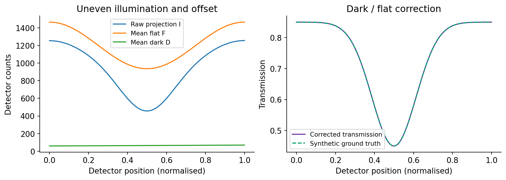

Dark and flat field correction
==============================

``dark_flat_field_correction``

Convert raw detector counts into transmission using averaged flat and dark frames. This compensates for detector offsets and illumination variations before stripe removal, phase retrieval or the negative logarithm.

Principle
---------

.. math::

   T = \frac{I - m_D\overline{D}}{\max\!\left(m_F\overline{F} - m_D\overline{D},\,\varepsilon\right)},\qquad \varepsilon=10^{-7}.

Usage and parameters
--------------------

Here :math:`I` is a projection, :math:`D` and :math:`F` are dark and flat stacks,
and the bars denote frame averages. :math:`m_D` and :math:`m_F` are the dark
and flat multipliers. The denominator floor avoids division by zero. Multipliers compensate intensity changes. Set lower_bound and upper_bound to clip transmission when needed; excessive clipping can hide acquisition problems.

Illustration
------------

   Synthetic example with unit multipliers: correction recovers transmission despite a spatially varying flat field and dark offset.

Realistic projection example
----------------------------

These are matching views from the realistic TomoPhantom model 7 acquisition,
using 20 flats, 10 darks and source intensity 20000. Both images have the same
30-pixel crop. The raw image displays detector counts with robust contrast;
the corrected image displays transmission on a fixed 0--1.1 range. They use
different intensity units, so their display scales are not shared.

.. list-table::

   * - .. figure:: ../../../_static/auto_images_methods/dark_flat_field_correction_input_proj.png
          :alt: Raw synthetic projection with illumination variations and detector offsets.

          Before correction: raw detector counts.

     - .. figure:: ../../../_static/auto_images_methods/dark_flat_field_correction_proj.png
          :alt: The matching projection after dark and flat field correction.

          After correction: transmission, before the negative logarithm.

Dark/flat correction compensates for illumination and detector offsets; it
does not remove zingers or all detector-response artefacts. The script also
saves matching sinogram views. See :doc:`../../../scripts/README` to regenerate
the figures. The separate ``normalisation`` images include the subsequent
negative logarithm and show line integrals instead of transmission.

Implementation reference
------------------------

See the `library implementation <https://github.com/DiamondLightSource/httomolibgpu/blob/main/httomolibgpu/prep/normalize.py>`_
for the precise numerical conventions used by this utility.

Background reading
------------------

For the transmission model, sampling and reconstruction context, see
Kak and Slaney, `Principles of Computerized Tomographic Imaging
<https://www.slaney.org/pct/>`_ (author-hosted text). The numerical
controls specific to this function are defined in the API above.

API reference
-------------

:func:`httomolibgpu.prep.normalize.dark_flat_field_correction` — signature, input/output types and full parameter details.
