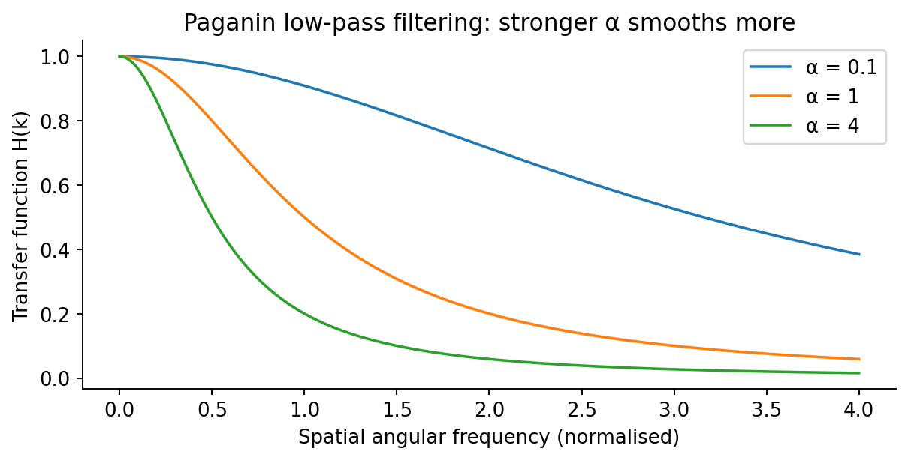

Paganin phase retrieval
=======================

``paganin_filter``

Retrieve single-material phase information from propagation-based projections while suppressing noise. Apply to dark/flat corrected transmission, before reconstruction.

Principle
---------

.. math::

   H(k_x,k_y)=\frac{1}{1+\alpha(k_x^2+k_y^2)}

Usage and parameters
--------------------

The positive coefficient alpha depends on wavelength, propagation distance and delta/beta, with the frequency convention included in the implementation. The filter includes a negative logarithm. Larger ratio_delta_beta smooths more. See :ref:`phase_contrast_module` for the physical model, units and real-data illustrations.

Illustration
------------

   Conceptual frequency response in normalised units, not a calibration or a library benchmark. Larger alpha suppresses high spatial frequencies more strongly.

Papers and further reading
--------------------------

* `Simultaneous phase and amplitude extraction from a single defocused image of a homogeneous object <https://doi.org/10.1046/j.1365-2818.2002.01010.x>`_.
* `Boosting spatial resolution by incorporating periodic boundary conditions into single-distance hard-x-ray phase retrieval <https://doi.org/10.1088/2040-8986/abbab9>`_.

Validation
----------

:doc:`Paganin reconstruction <../../../validation/preprocessing/paganin_reconstruction>`
applies phase retrieval to the biological sample in I12 dataset 6 and compares
five reconstructed slices with and without filtering.

API reference
-------------

:func:`httomolibgpu.prep.phase.paganin_filter` — signature, input/output types and full parameter details.
